  

  

 

Some people learn to code. **Jeff makes code do his job for him.**

By day he builds **agentic AI systems** at **i1Solutions** in Midrand: robots that read service-desk tickets, reason about them with Claude, and route them before anyone has finished their coffee. By night he's a **founder**, a **media operator** and a **researcher**, and somewhere in between he finishes a **Bachelor of Computing (Software Engineering)** at Belgium Campus iTversity like it's a side quest.

He's 21. Most people at 21 are figuring out what an API is. Jeff is wiring LLMs into enterprise workflows and shipping them.

> [!WARNING]
> Prolonged exposure to this profile has been linked to sudden urges to **hire him**, **fund him**, or **quit your job and become his intern**. Proceed with caution.

<table>
<tr>
<td width="50%" valign="top">

**🧠 Day job:** Agentic Automation & RPA @ **i1Solutions** (title says intern, the output disagrees) 
**🏅 Certified:** UiPath Automation Associate (Jul 2026), agentic certs loading 
**🚀 Founder:** [ApplyMaxx](https://applymax.xyz), job-hunting for South Africa, maxxed 
**🎓 Studying:** BComp, Software Engineering @ Belgium Campus

</td>
<td width="50%" valign="top">

**📡 Media:** Runs **Mzansi 101**, an automated TikTok newsroom 
**🚦 Research:** AI-driven adaptive traffic signals for SA cities 
**📍 Based:** Midrand, Johannesburg 🇿🇦 
**⚡ Fun fact:** has never met a manual process he didn't automate

</td>
</tr>
</table>

 

  
  

  
  

  
  

 

 

  

  
  
  
  
  
  
  
  

 

  
  

Most of the heavy artillery runs in private UiPath projects and enterprise repos. GitHub only sees the side quests.

 

> *"I used to sit in the backlog for weeks. Now I'm triaged before I finish loading."*
> — **A Jira ticket**

> *"He wrote me, then made me do his job. I respect it."*
> — **Stuart Bot**

> *"We heard he's simulating us in SUMO. We're scared."*
> — **Every traffic light in Johannesburg**

> *"Ran clean on the first try. Suspicious, honestly."*
> — **His terminal, 2 a.m.**

 

### 🛰️ Open a channel

  

Built cold. Runs hot. ♥ KholdHart

